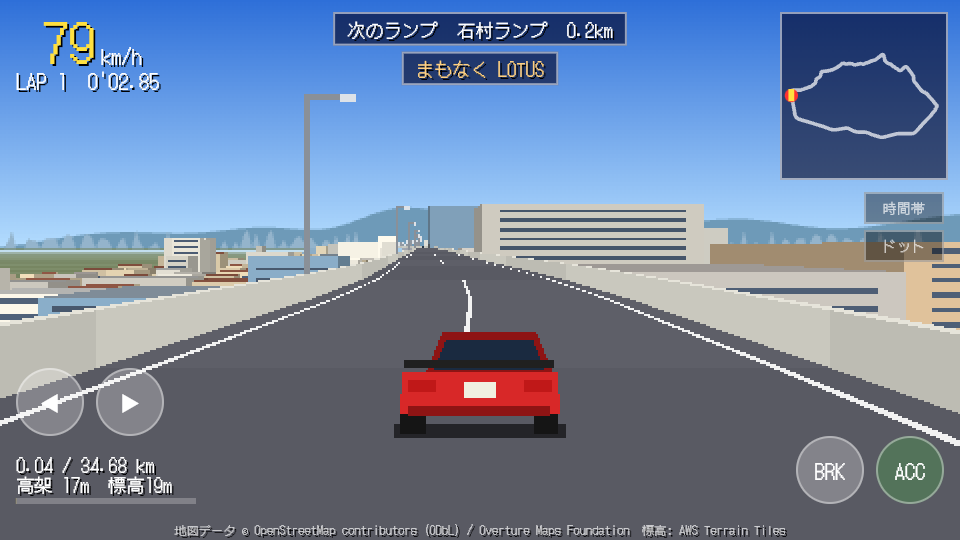

# 福岡都市高速 環状線ドライブ

福岡市の都市高速 環状線（内回り 34.68km）を、実際の地図・標高・建物データから作ったコースで周回する、レトロゲーム風の疑似3Dドライブゲームです。生成AI（Claude）と一緒に作っています。



## 構成

| フォルダ | 内容 |
|---|---|
| [`flutter-app/`](flutter-app/) | ゲーム本体（Flutter / Web で動作確認）。操作方法やビルド手順は中の README |
| [`course-data/`](course-data/) | コースと沿線建物のデータ、および再生成用の Python スクリプト |

## すぐ遊ぶ

ブラウザ版: https://takano4geru.github.io/batrun/ （main への push で GitHub Actions が自動ビルド・公開します）

ローカルで動かす場合:

```
cd flutter-app
flutter pub get
flutter run -d chrome
```

ゲームに必要なデータ（`flutter-app/assets/course_data.json`）はリポジトリに含まれています。

## 大きいデータについて

沿線建物の全量データ（`course-data/scenery_ring_inner*.json/.geojson`、各 11〜13MB）と標高点群（`*.npy`）はリポジトリに含めていません。
[Releases](../../releases) に添付するか、`course-data/README.md` の手順でスクリプトから再生成できます。

## ライセンス

- **プログラム**（`flutter-app/lib`、`flutter-app/tool`、`course-data/scripts` など）: [MIT License](LICENSE)
- **データ**: 元データのライセンスに従います。詳しくは [NOTICE.md](NOTICE.md) を参照してください。
  - コース線形など OpenStreetMap / Overture Maps 由来のデータは **ODbL 1.0**
  - 建物は国土交通省 Project PLATEAU、地盤標高は国土地理院 標高タイルを加工したもの
- **フォント** DotGothic16: SIL Open Font License 1.1
