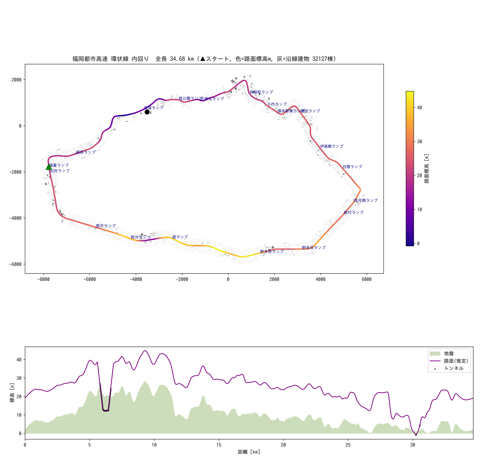

# 福岡都市高速 環状線 コースデータ

レトロ風疑似3Dレースゲーム用に、福岡都市高速 環状線（内回り）の実際の線形と沿線建物をデータ化したものです。



## ファイル

| ファイル | 内容 |
|---|---|
| `course_ring_inner.json` | ゲーム用コース。10m 間隔の `segments`（`curve`, `z`, `level`, `tunnel`）とランプ位置 `landmarks` |
| `course_ring_inner_centerline.csv` | 5m 間隔の中心線（x/y/z, 経緯度, 方位, 曲率, 勾配, 地盤高, 道路名） |
| `scenery_ring_inner.json` | **PLATEAU 版**。中心線から 300m 以内の建物 30,919 棟（コース距離 `s`、横オフセット、計測高さ、外形、用途） |
| `scenery_ring_inner.geojson` | 同じ建物の確認用 GeoJSON（QGIS 等で表示可） |
| `scenery_ring_inner_osm.json` / `.geojson` | 旧版（Overture / OSM 由来 32,127 棟）。比較・名前の移植元として残しています |
| `preview_ring_inner.png` | コース平面図と縦断図（縦断図・色は旧推定のまま。最新の縦断は `profile_ring_inner.png`） |
| `profile_ring_inner.png` | 縦断図：国土地理院 DEM の地盤と新しい路面高（旧推定も薄く表示） |
| `dem_points_gsi_ring_inner.npy` | 中心線 40m 以内の国土地理院 標高タイル画素 172,863 点（x, y, 標高。ローカル平面[m]）。現在の地盤高の元データ |
| `dem_points_ring_inner.npy` | 同じ範囲の PLATEAU 地形モデル TIN 頂点 113,462 点（比較・予備用） |
| `scripts/` | 再生成用スクリプト一式（下記） |

## コースの概要

- 全長 34.68 km の閉じた周回（反時計回り）。スタートは福重 JCT 付近。
- OSM の路線リレーション「福岡都市高速環状線内回り」に属する 33 区間をつないで作成。
- 最小カーブ半径 約107m、トンネル 約0.9km、地盤標高 0〜33.0m（国土地理院 DEM5A）、路面標高 4.5〜43.8m、最大勾配 3.5%。

### 疑似3Dエンジンでの使い方

`segments[i]` を 1 セグメント（10m）として順に描画します。

- `curve`: そのセグメントで進行方向が変わる量 [rad]。正が右カーブ。ゲーム側で好みの倍率をかけて使う想定です（実データのままだと緩いので 20〜50 倍程度が目安）。
- `z`: 路面標高 [m]。起伏表現にそのまま使えます。
- 建物は `scenery_ring_inner.json` の `s`（コース上の距離）と `offset`（進行方向右が正、[m]）でスプライト配置し、`height` と `w` で大きさを決めます。

## 高低差について

2026-10-09 から地盤標高は実測ベースの DEM です。高架の地上高だけが推定です。

- **地盤高（実測）**: 国土地理院 標高タイル（https://cyberjapandata.gsi.go.jp/xyz/）。z15 の DEM5A（航空レーザ測量、5m メッシュ、建物・高架を除いた地面）を使い、欠けている画素は DEM5B → DEM5C → DEM10B で埋める。沿線ではレーザの DEM5A が 95%（164,482 画素）、残りの水面などが DEM10B。中心線の各点（5m 間隔）で半径20m 内の画素をガウス重み（σ=6m）平均し、約15m 窓で平滑化。
  - PLATEAU 地形モデル（原典は国土地理院 基盤地図情報 DEM）とも比べました。差の中央値は -0.15m で、90% の地点で ±1m 以内に収まります。最も大きい差は板付付近（14.9km）の 8m です。
- **高架の地上高（推定）**: OSM の `layer` から 0=0m, 1=6m, 2=9m, 3=12m（標準の高架）, 4=18m（他路線を跨ぐ区間）。この路線は OSM でほぼ全線 layer=3 なので、実質「地盤 + 12m」。
  - 高架の基準面は「中心線 ±40m の地面の 75% 点」を約200m の移動中央値でならしたもの。御笠川沿い（板付付近）のように川の上を通る区間でも、路面が川底に引きずられて沈みません。
- **トンネル**: 両坑口の高さを直線で結び、坑口の前後 300m で地表から高架の高さへすり付け。
- 縦断は約200m 窓×2 で平滑化し、勾配 6% を上限に制限（結果の最大勾配 3.5%）。
- 旧版（AWS Terrain Tiles + layer 1=7m…3=17m）より路面が全体に 3〜10m 低くなっています。

```
python3 scripts/dem_elevation.py extract-gsi course_ring_inner_centerline.csv dem_points_gsi_ring_inner.npy   # 国土地理院タイル 48 枚(+DEM10B)を取得
python3 scripts/dem_elevation.py apply . dem_points_gsi_ring_inner.npy gsi   # CSV の ground_m/z_m/grade と JSON の z, ground を上書き
# PLATEAU 地形モデルを使う場合:
SSL_CERT_FILE=<CAバンドル> python3 scripts/dem_elevation.py extract course_ring_inner_centerline.csv \
  https://assets.cms.plateau.reearth.io/assets/c5/263250-3d72-486d-8b76-f8c62aaaca03/40130_fukuoka-shi_city_2024_citygml_2_op.zip \
  dem_points_ring_inner.npy        # 沿線の udx/dem だけ約230MB を Range 取得
python3 scripts/dem_elevation.py apply . dem_points_ring_inner.npy plateau
```

`build_course.py` を再実行すると旧方式の標高に戻るので、その後に必ず `dem_elevation.py apply` を実行してください。`course_ring_inner.json` の各 segment には `ground`（地盤高）も入っています。

## 建物データ（PLATEAU）

2026-10-09 から建物は国土交通省 Project PLATEAU 福岡市 3D都市モデル（2024年度 v4, CityGML）を使っています。

- 沿線 59 メッシュの bldg GML を zip から部分取得（約1GBの zip 全体はダウンロードしない）し、中心線から 300m 以内の 30,919 棟を抽出。
- 高さは全棟 `measuredHeight`（航空測量による計測値）。中央値 7.8m、95%点 18.7m、最高 141.5m（ヒルトン福岡シーホーク）。
- 外形は LOD0 / LOD1 底面。用途コード `bldg:usage` を `class` に変換（住宅 16,170、共同住宅 4,924、業務 1,851、学校 1,257、商業 1,136 ほか。不明 461 は 4,325 棟）。
- PLATEAU には建物名がほぼ無いため、旧 OSM 版の名前付き建物 456 件を、重心が 25m 以内の PLATEAU 建物へ移しています（`name_src: "OSM"`）。
- 福岡タワーは PLATEAU の建物データに含まれません（ゲーム側で別途描画）。

```
SSL_CERT_FILE=<CAバンドル> python3 scripts/extract_plateau.py extract course_ring_inner_centerline.csv \
  https://assets.cms.plateau.reearth.io/assets/c5/263250-3d72-486d-8b76-f8c62aaaca03/40130_fukuoka-shi_city_2024_citygml_2_op.zip \
  scenery_ring_inner.json
python3 scripts/extract_plateau.py names scenery_ring_inner.json scenery_ring_inner_osm.json
```

`extract_plateau.py` は numpy と標準ライブラリだけで動きます。入力は展開済みディレクトリ、CityGML の zip、zip の URL のどれでも可。データ入手先: https://www.geospatial.jp/ckan/dataset/plateau-40130-fukuoka-shi-2024

道路（コース線形）は従来どおり Overture Maps の transportation データ（OSM 由来）です。

## 再生成手順

`scripts/scan.py` → `seg.py` / `bld.py`（Overture から福岡市周辺を切り出し）→ `build_course.py` → `dem_elevation.py`（標高）→ `build_scenery.py`（OSM 版建物）→ `extract_plateau.py`（PLATEAU 版建物）→ `preview.py`。必要ライブラリ: pyarrow, fsspec, aiohttp, shapely, numpy, pillow, matplotlib。

## 出典・ライセンス

- 道路・建物データ: © OpenStreetMap contributors。Open Database License (ODbL) 1.0 に基づき提供。https://www.openstreetmap.org/copyright
  - Overture Maps Foundation 経由で取得（https://overturemaps.org/）。本データは ODbL の派生データベースのため、配布する場合は ODbL を継承し、上記の出典表記を表示してください。
  - 一部の建物は Overture が取り込んだ doi:10.5281/zenodo.8174931 由来です。
- 標高: 「国土地理院 標高タイル（DEM5A・DEM10B）を加工して作成」（国土地理院コンテンツ利用規約。出典表示が必要）。旧版の AWS Terrain Tiles は使っていません。
- 建物: 「出典：国土交通省 Project PLATEAU（福岡市 3D都市モデル）を加工して作成」と表記してください（PLATEAU サイトポリシーに基づく。CC BY 4.0 互換）。建物名の一部は OSM 由来（ODbL）。

ゲーム内のクレジット例:

> 地図データ © OpenStreetMap contributors (ODbL) / Overture Maps Foundation
> 3D都市モデル: 国土交通省 Project PLATEAU / 標高: 国土地理院
